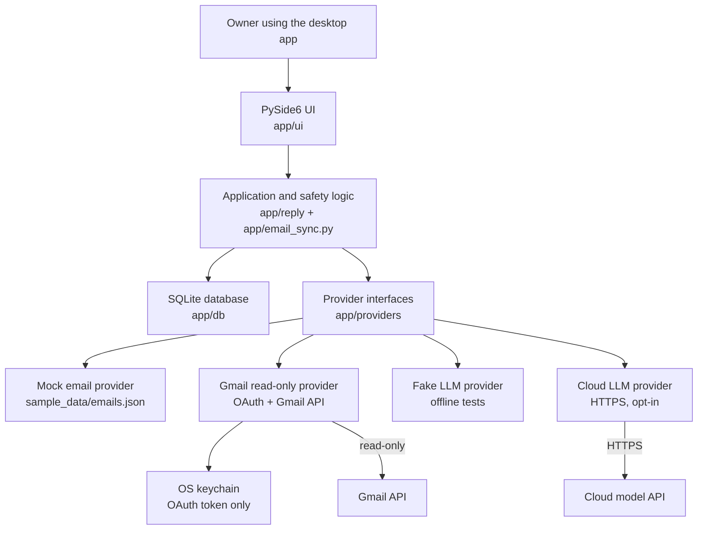
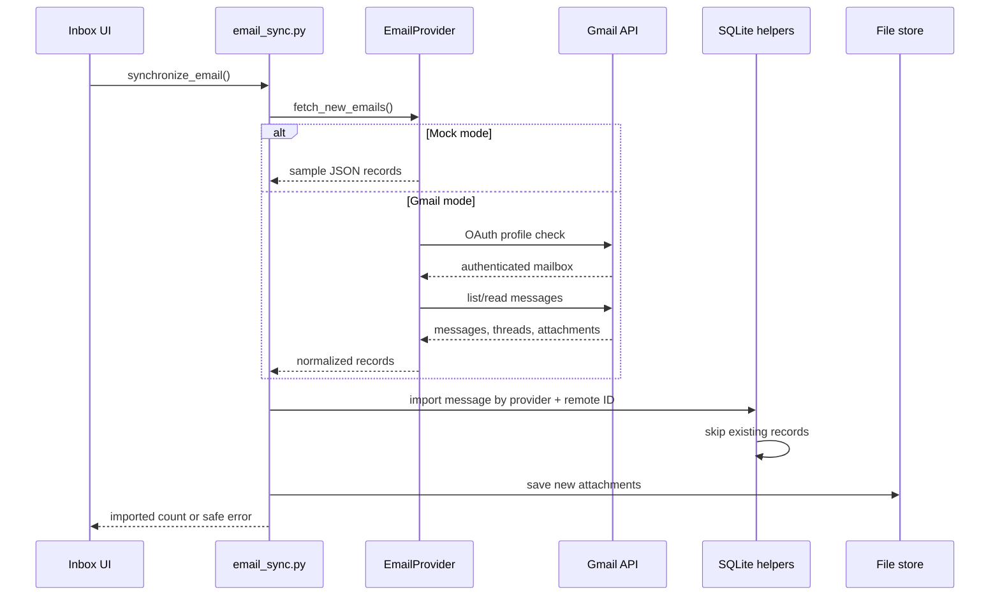
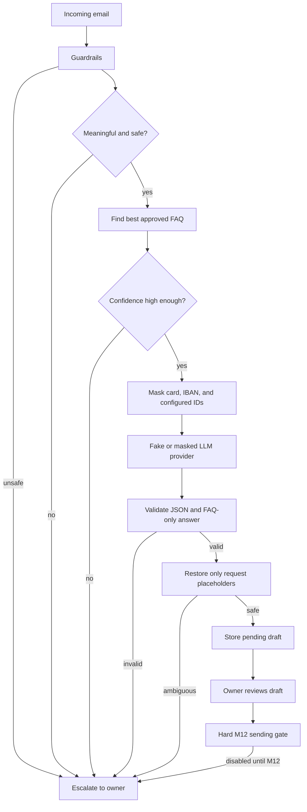
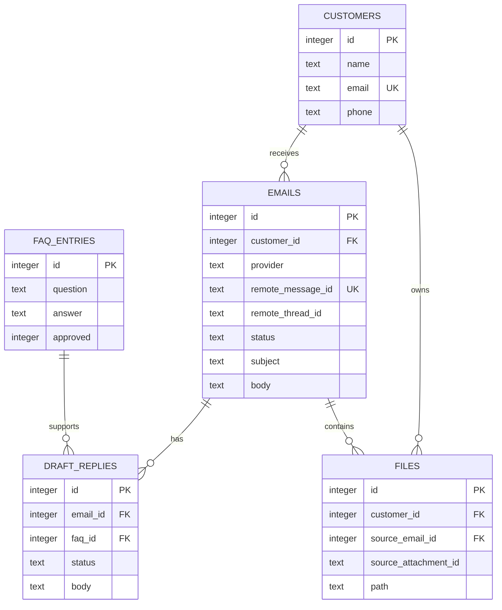

# Mini CRM architecture map

This document is a visual overview of the Mini CRM. It is intended for
learning, presentations, and quick navigation through the code.

## 1. One-page overview



### Main rule

The UI does not write SQL and does not call Google or cloud SDKs directly.
It calls application functions, which use database helpers and provider
interfaces.

## 2. Important folders

```text
mini-crm/
|
|-- app/
|   |-- main.py                 Application startup and provider selection
|   |-- config.py               .env loading and safe configuration validation
|   |-- privacy.py              Personal-data masking and safe restoration
|   |-- email_sync.py           Fetch + import orchestration
|   |
|   |-- db/                     All SQLite access lives here
|   |   |-- schema.sql          Tables and base schema
|   |   |-- database.py         Database creation and legacy migrations
|   |   |-- customers.py        Customer queries
|   |   |-- emails.py           Email import, status, and deduplication
|   |   |-- drafts.py           Reply draft persistence
|   |   |-- faqs.py             Approved FAQ queries
|   |   `-- files.py            Customer files and attachments
|   |
|   |-- providers/              External services behind interfaces
|   |   |-- email_base.py       EmailProvider contract
|   |   |-- email_mock.py       Offline sample email provider
|   |   |-- gmail.py            Gmail OAuth read-only provider
|   |   |-- llm_base.py         LLMProvider contract
|   |   |-- llm_fake.py         Deterministic offline LLM
|   |   |-- llm_cloud.py        Optional HTTPS cloud adapter
|   |   |-- llm_masked.py       Masking boundary for LLM calls
|   |   `-- audit.py            Privacy-safe provider audit records
|   |
|   |-- reply/                  Safe FAQ reply workflow
|   |   |-- guardrails.py       Refund, legal, anger, money, and unclear checks
|   |   |-- matcher.py          Approved FAQ matching
|   |   |-- drafter.py          Strict FAQ-only reply validation
|   |   |-- pipeline.py         Guard -> match -> draft -> persist
|   |   `-- approval.py         Owner approval and hard sending gate
|   |
|   |-- prompts/
|   |   `-- reply_v1.txt        Versioned cloud prompt
|   |
|   `-- ui/                    PySide6 screens
|       |-- main_window.py      Main tabs and dependency wiring
|       |-- customers.py        Customer list and customer actions
|       |-- inbox.py            Email list and sync/import actions
|       |-- approval.py          Approval queue controls
|       |-- customer_files.py   Customer attachment view
|       |-- settings.py         Mode/provider settings
|       `-- privacy_preview.py  Masked “what we send” preview
|
|-- tests/                      Offline automated checks
|   |-- golden/emails.json      64 expected safety outcomes
|   |-- run_evals.py            Golden-set evaluator
|   `-- test_*.py               Unit and UI tests
|
|-- specs/                      Milestone acceptance criteria
|-- .env.example                Names and placeholder values only
|-- PLAN2.md                    Roadmap and milestone status
`-- LEARNING_NOTES.md           Beginner explanations after milestones
```

## 3. Email import flow



Gmail is read-only in the current version. It requests only
`gmail.readonly`, stores OAuth tokens in the OS keychain, and verifies the
configured test mailbox before listing messages.

## 4. Reply-drafting flow



The model is never allowed to answer from general knowledge. It may only
rewrite an owner-approved FAQ answer. Nothing is sent automatically.

## 5. Database map



Email deduplication uses the provider and remote message ID. Attachment
deduplication uses the source email and remote attachment ID.

## 6. Configuration and secrets

```text
.env
  |
  +--> app/config.py
          |
          +--> Mock
          |      `-- no network and no secrets required
          |
          +--> cloud
          |      `-- HTTPS endpoint + model + API-key environment variable
          |
          `--> gmail
                 `-- test mailbox + external OAuth credentials path
                         |
                         `-- OS keychain stores OAuth token
```

The real `.env` file, OAuth client JSON, OAuth token, databases, and API keys
must never be committed. `.env.example` contains names only.

## 7. Safety boundaries

| Boundary | Enforced by | Current behavior |
|---|---|---|
| UI to database | UI calls `app/db/` helpers | UI does not write SQL |
| UI to external service | Provider interfaces | UI does not import Google SDK |
| Cloud prompt privacy | `MaskedLLMProvider` and `app/privacy.py` | Sensitive values are masked before transport |
| Cloud response safety | `drafter.py` and restoration checks | Invalid or ambiguous responses escalate |
| Gmail account safety | `GmailProvider` profile check | Configured test mailbox must match |
| OAuth token safety | OS keychain | Tokens are not stored in SQLite, `.env`, or files |
| Email sending | `approval.py` and provider boundary | Hard-disabled until M12 |
| Audit privacy | `audit.py` and sanitized errors | Metadata only, no prompt/body/token text |

## 8. Milestone map

```text
M01-M07  Core CRM, inbox, FAQ replies, approval queue, files, statuses
    |
M08      Settings, Mock/Dry-run/Live modes, secret-name configuration
    |
M09      Optional cloud LLM adapter, retries, structured output, audit
    |
M10      Personal-data masking, safe restoration, masked preview
    |
M11      Gmail read-only OAuth, mailbox check, import, attachments
    |
M12      Planned: Gmail drafts, then allowlisted sending after approval
M13      Planned: attachment intelligence and OCR
M14      Planned: hardening, kill switch, limits, backup, GDPR deletion
```

## 9. How to explain the project in one minute

> Mini CRM is a PySide6 desktop CRM with SQLite storage. Incoming email comes
> through a provider interface, either from offline sample data or Gmail
> read-only OAuth. Safety rules check the message first, then an approved FAQ
> is matched. An optional model may rewrite that FAQ after sensitive data is
> masked, but the result is validated and placed in an approval queue. The
> owner remains in control: sending is hard-disabled until a future milestone,
> and audit records contain metadata rather than private message content.

## Related documentation

- [Architecture](./ARCHITECTURE.md)
- [Roadmap](./PLAN2.md)
- [Learning notes](./LEARNING_NOTES.md)
- [M11 specification](./specs/m11.md)
- [M10 specification](./specs/m10.md)
